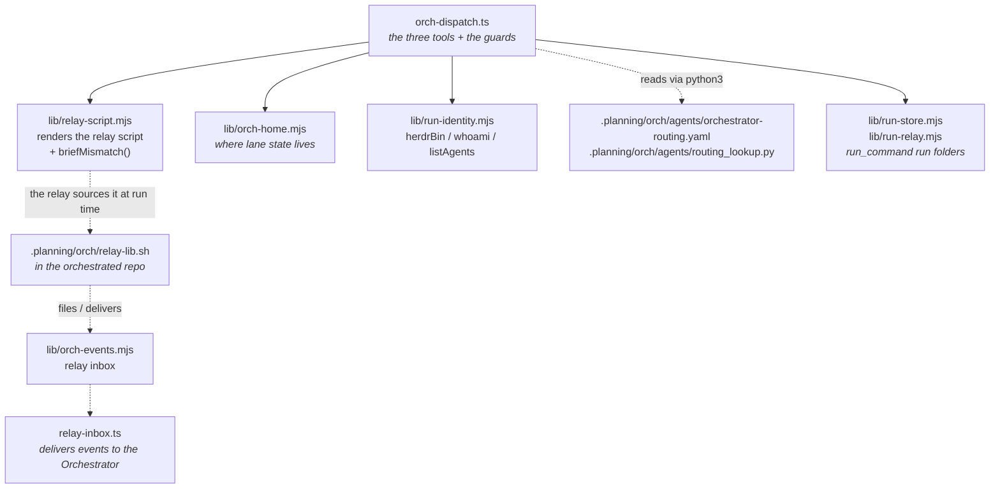
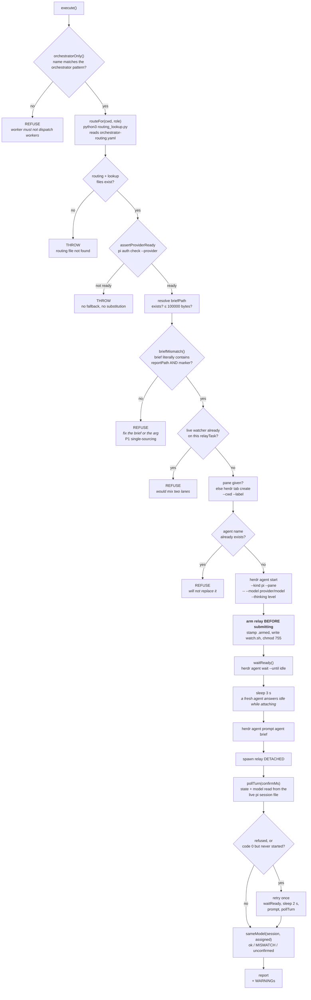
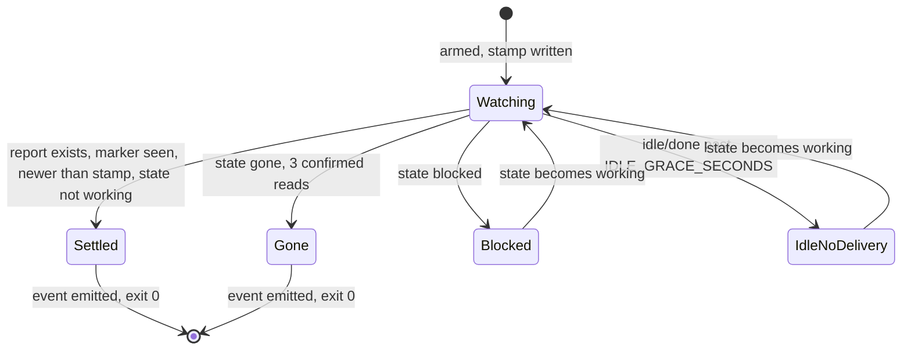
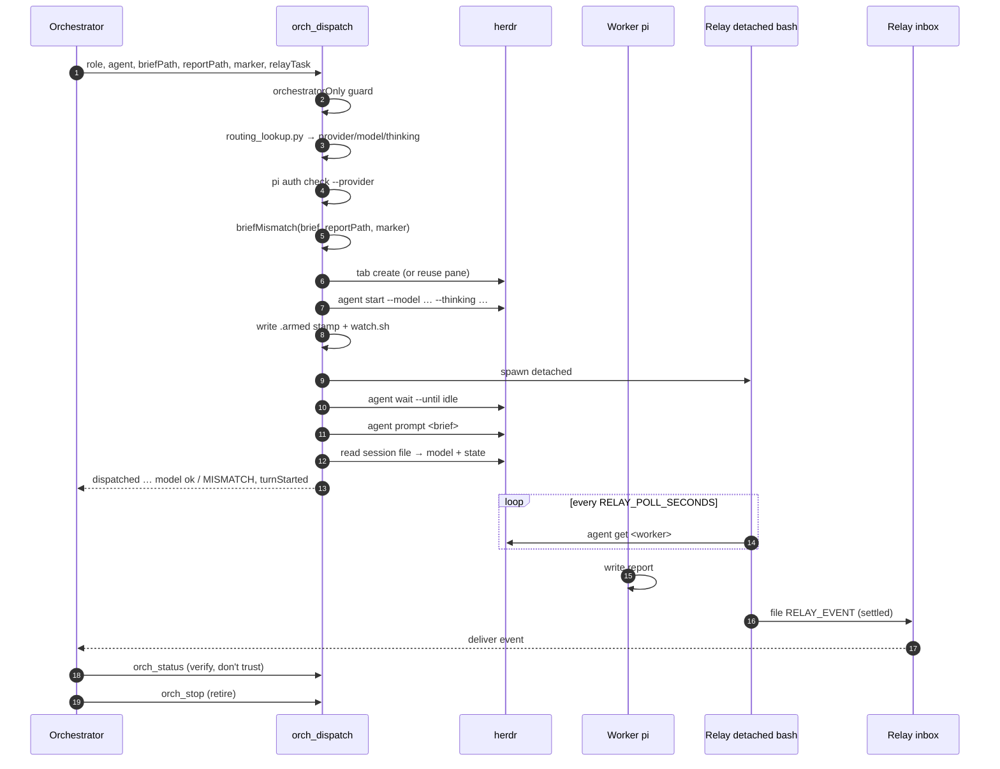

# `orch-dispatch.ts` — Orchestrator dispatch tools

One extension, three tools (`orch_dispatch`, `orch_status`, `orch_stop`), for starting
a worker on the model its **role** is assigned, watching it, and retiring it.

Files that make up this extension:



**Co-location requirement.** `orch-dispatch.ts` and `./lib/` must travel together. A
copy of the `.ts` without its sibling `lib/` fails at import time. Never copy one
without the other.

---

## Why this exists

On **2026-10-01** the Orchestrator hand-typed `herdr agent start <name> --kind pi
--pane <pane>` seven times without pinning a model. Every one silently came up on pi's
**default** model instead of the routing assignment, and one was a reviewer running the
same model family as the executor it was judging.

> Remembering is not a control.

So the tool reads the routing file, verifies the provider is actually authenticated,
pins `--model` explicitly, and then **reads the chosen model back out of the live pi
session** to confirm what really happened. There is no default role and no fallback
provider: an unassigned role is an error.

It also collapses the rest of the hand-run dance: create the tab, refuse to clobber a
live agent, submit the brief, arm a watch-only relay gated on a freshness stamp, and
confirm the agent actually started a turn.

---

## Guard: Orchestrator-only

All three tools are **registered in every session but refuse to run outside the
Orchestrator**, because the Orchestrator is the sole control plane and a worker must
not dispatch workers.

Identity is resolved in two steps, first hit wins:

1. `pi.getSessionName()` — the pi session name.
2. `process.env.HERDR_PANE_ID` → `herdr agent list` → the name of the agent that owns
   this pane.

That name must match:

```regex
^orchestrator(-[a-z0-9]+)*$
```

One orchestrator per space, so `orchestrator`, `orchestrator-masking` and
`orchestrator-tskctl` all pass, while `extensibility-orchestrator` does **not** (the
pattern is anchored: a substring test would match a worker named
`orch-something`). Anything else is refused with instructions to run `/name
orchestrator`.

The same pattern is reused by `lib/orch-events.mjs` and `lib/run-store.mjs`, and the
shell side mirrors it in `.planning/orch/relay-lib.sh`.

---

## Lane state: where non-repo files live

Relay scripts, the relay inbox and run folders are **per repo**, keyed by the repo
directory name, so two projects never share a `/tmp` namespace:

```text
/tmp/orch/<repo>/relay/                    relay scripts + .armed stamps + -relay.log
/tmp/orch/<repo>/relay-inbox/              pending/ and processed/ event files
/tmp/orch/<repo>/runs/run-command/         run_command run folders
```

Resolution order, highest first: `ORCH_HOME` → a one-line
`.planning/orch/orch-home` pin file in the repo → `/tmp/orch/<basename(cwd)>`.
Per-consumer overrides still win over the shared root: `ORCH_RELAY_DIR`,
`ORCH_EVENTS_DIR`, `RUN_COMMAND_RUNS_DIR`.

Defined once in `lib/orch-home.mjs`; the shell side mirrors it in `relay-lib.sh`.
Paths are resolved **lazily, at call time** — never captured at module load — because
the extension host imports the module once but the right directory depends on the
session's cwd.

> This used to be hardcoded to `/tmp/trino-scenario-decisions/...` — the project where
> the machinery was first built. See "History" at the end.

---

## Tool 1 — `orch_dispatch`

> Start a worker on its role's assigned model and arm a completion relay.

### Parameters

| Parameter | Required | Default | Description |
| --- | --- | --- | --- |
| `role` | ✅ | — | `planning` \| `implementation` \| `reviewer` \| `architect` \| `interlocutor` \| `deliberation` \| `research`. Selects the model. No default. |
| `agent` | ✅ | — | Unique agent name, `[a-z][a-z0-9_-]{0,31}`. |
| `briefPath` | ✅ | — | Path to the brief file whose **contents** are submitted. |
| `reportPath` | ✅ | — | The report the relay waits for. |
| `marker` | ✅ | — | Marker string that must appear in that report. |
| `relayTask` | ✅ | — | Relay TASK name, e.g. `T9-B-R2-REVIEW`. Must be unique per dispatch. |
| `tskId` | — | `""` | Board task id carried in the `RELAY_EVENT`. |
| `pane` | — | — | Existing shell pane. Omit to create a tab. |
| `tabLabel` | — | — | Tab label when creating a tab. Required if `pane` is omitted. |
| `tabCwd` | — | session cwd | Working directory for the new tab. |
| `workspace` | — | this orchestrator's own workspace | Workspace for the new tab. |
| `confirmMs` | — | `25000` | Milliseconds to await turn + model confirmation. |
| `allowUnmatchedBrief` | — | `false` | Escape hatch for the brief cross-check. Only for a verified false refusal (e.g. a path written across lines). **Record the reason.** |

Give **either** `pane` **or** `tabLabel`.

### The flow



### Key ordering decisions

- **Arm before submit.** The `.armed` stamp must predate the report, or the relay's
  freshness gate would never let it settle.
- **Sleep 3 s before the first prompt.** A freshly started pi agent reports `idle`
  while it is still attaching, and a prompt in that window is **silently dropped**
  (observed on every dispatch of the 2026-10-01 wave).
- **Retry exactly once, and never on a bare timeout.** Two ways a brief is lost were
  observed live:
  1. the prompt command is *refused* while the agent is still settling
     (`not ready` / `stalled` / `timeout`), or
  2. the command **succeeds** but no turn ever starts — the agent sits at an empty
     prompt, which silently produced an idle worker that *looked* dispatched.

  A bare timeout proves neither, so it is not retried.

### What it returns

A text block plus structured `details`:

```text
dispatched t179_architect  role=architect
  assigned model : opencode-go/glm-5.3-flash  thinking=high
  session model  : opencode-go/glm-5.3-flash  -> ok
  pane           : wE:p7   tab=wE:t9
  brief          : .../T179.brief.md (4210 bytes)
  prompt         : submitted
  ready before   : yes
  state after    : working
  relay          : /tmp/orch/masking/relay/T179-COMPILE-watch.sh
  report gate    : /tmp/orch/masking/reports/T179.md must contain "SPECS_COMPILED" and be newer than ...
```

Two warnings can be appended:

- `WARNING: the live session is NOT on the assigned model. Fix this before trusting
  any output.` (`modelConfirmed` false)
- `WARNING: no working/blocked/done state was observed; the brief may not have started
  a turn.` (`turnStarted` false)

`details` carries `provider`, `assignedModel`, `assignedThinking`, `sessionModel`,
`modelConfirmed`, `pane`, `tab`, `briefPath`, `reportPath`, `marker`, `relayScript`,
`relayTask`, `promptAccepted`, `promptRetried`, `readyBeforePrompt`, `promptNote`,
`state`, `turnStarted`.

### Model comparison

`sameModel()` normalizes case and strips `. _ - /` before comparing **whole** ids.
pi writes some ids with punctuation swapped (`github-copilot/claude-sonnet-5.5` is
recorded as `claude-sonnet-5-5`), which produced a **false mismatch** on the first
dispatch under the new routing. Both directions matter: a false alarm teaches distrust
of valid work, and a comparison loose enough to hide a real substitution would defeat
the point of reading the model back at all. Never a prefix, never a substring.

### Refusals

| Refusal | Cause |
| --- | --- |
| `the orch_* tools are Orchestrator-only` | session name does not match the pattern |
| `routing file not found` / `routing lookup not found` | `.planning/orch/agents/` incomplete |
| `provider '<p>' is not ready` | `pi auth check` did not say `ready`. **No substitution is made.** |
| `brief not found` | bad `briefPath` |
| `brief is N bytes (limit 100000)` | prompt the agent with the path instead |
| `the brief ... does not literally contain reportPath ... and marker` | P1 single-sourcing check |
| `relayTask ... still has a live watcher` | pick a unique `relayTask` |
| `an agent named 'x' already exists` | stop it first, or pick another name |
| `give either pane ... or tabLabel` | neither supplied |
| `the loaded orch_dispatch predates the brief cross-check` | session predates the change: run `/reload` |

---

## The relay it arms

The relay is a **plain watch-only bash script** — not a model, no tokens. It watches
ONE agent and reports a fact. It never edits the board, never judges an outcome, and
never re-submits the brief.



Each event is **written to the relay inbox first** (durable, survives the Orchestrator
not listening yet); only if that write fails does it fall back to the older text
prompt. Exactly one of the two paths runs, so an event is never delivered twice.

| Status | Meaning |
| --- | --- |
| `settled` | Report present, marker seen, newer than the arm stamp. Earns a **board update**. |
| `gone` | Agent left the herdr registry (3 confirmed reads). Asks only to be **looked at**. |
| `provider_error` | Agent is `blocked`; the in-agent provider-error hook makes it visible. |
| `idle_no_delivery` | Continuously idle/done past the grace period without the gate tripping. Names what is missing (`report-missing` vs `marker-missing`). One event per gap. |

Tunables: `RELAY_POLL_SECONDS` (default 20), `IDLE_GRACE_SECONDS` (default 180).

`ORCHESTRATOR_ACTION` is derived from the status and **never** from what the sender
wrote: only `settled` earns `update-tsk-board`; everything else is `inspect-agent`.

**The relay resolves its control plane at fire time, never from a hardcoded name.**
`relay_target` picks the single live agent matching `^orchestrator(-[a-z0-9]+)*$` whose
`cwd` is the relay's own repo. `ORCH_TARGET` pins it explicitly; an unresolvable or
ambiguous target **fails closed** rather than firing at a guess. The watched agent is
deliberately *not* used to find the workspace: relays fire after the worker has
settled, and a settled worker is often already gone from the registry.

---

## Tool 2 — `orch_status`

> Read workers' live state, model, and report/relay status.

| Parameter | Required | Description |
| --- | --- | --- |
| `agents` | ✅ | Agent names to inspect. |

Nothing is cached: state and model come from Herdr and from each agent's own pi
session file. Per agent it reports `exists`, `state`, `pane`, `cwd`, `model`, and — if
a relay was armed for it — the relay `script`/`task`/`alive`, plus
`report { path, present, markerSeen, newerThanStamp, mtime }`.

Use it instead of several `herdr agent get` calls. Treat `idle`/`done` as completion;
a relay event is only a **trigger to go and look**.

---

## Tool 3 — `orch_stop`

> Retire workers: send `/quit` through the pane, wait until the agent is actually
> GONE, then close the pane.

| Parameter | Required | Default | Description |
| --- | --- | --- | --- |
| `agents` | ✅ | — | Agent names to retire. |
| `closePane` | — | `true` | Close the pane after the agent is gone. |
| `timeoutMs` | — | `60000` | Milliseconds to wait for each agent to disappear. |

It **verifies disappearance instead of assuming the quit worked**: `/quit` via
`herdr pane run`, then poll `herdr agent get` every `1500 ms` until gone or timed out.
Only then is the pane closed. Outcomes: `already gone`, `gone`, `STILL PRESENT after
timeout`, plus `paneClosed` / `paneCloseError`.

---

## End-to-end



---

## Configuration reference

| Knob | Default | Effect |
| --- | --- | --- |
| `ORCH_HOME` | `/tmp/orch/<repo>` | Whole lane-state root. |
| `ORCH_RELAY_DIR` | `$ORCH_HOME/relay` | Relay scripts + stamps + logs. |
| `ORCH_EVENTS_DIR` | `$ORCH_HOME/relay-inbox` | Relay inbox root. |
| `RUN_COMMAND_RUNS_DIR` | `$ORCH_HOME/runs/run-command` | run_command run folders. |
| `RELAY_POLL_SECONDS` | `20` | Relay poll interval. |
| `IDLE_GRACE_SECONDS` | `180` | Idle-without-delivery grace period. |
| `ORCH_TARGET` | *discovered* | Pin the control-plane agent to wake. |
| `.planning/orch/orch-home` | — | One-line pin file naming this repo's state root. |

Compile-time constants in `orch-dispatch.ts`:

| Constant | Value | Meaning |
| --- | --- | --- |
| `MAX_BRIEF_BYTES` | `100_000` | Larger briefs are refused; prompt with the path instead. |
| `DEFAULT_CONFIRM_MS` | `25_000` | Turn + model confirmation window. |
| `DEFAULT_STOP_MS` | `60_000` | Stop timeout. |
| `POLL_MS` | `1_500` | Stop polling interval. |
| `SESSION_SCAN_BYTES` | `262_144` | Head of the session file scanned for the model id. |
| `ORCHESTRATOR_NAME_RE` | `^orchestrator(-[a-z0-9]+)*$` | Who may use these tools. |

---

## History

The three state paths were hardcoded to `/tmp/trino-scenario-decisions/{relay,
relay-inbox,runs/run-command}` — the project where the machinery was first built. Any
other repo running an orchestrator inherited them, so two projects shared a `/tmp`
namespace, and `.planning/orch/relay-lib.sh` (a per-repo copy) hardcoded both the trino
repo root and the bare agent name `orchestrator` in `relay_fire` / `relay_fire_status`.

The visible symptom: a relay armed in the `masking` workspace fired its settle event
at the **trino** control plane. Making the target *data* instead of a literal — resolved
from the live registry by name pattern **and** cwd — is what fixed it.

The same audit found masking's `relay-lib.sh` copy was **stale** as well as
hardcoded: `lib/relay-script.mjs` calls `relay_is_gone`, `relay_blocked_label`,
`relay_fire_status` and `relay_emit_event`, and the copy defined none of them, so a
generated relay would have died on `command not found` even after the target was
corrected.

**Migrating a project that has state at a legacy path:** add a pin file or set
`ORCH_HOME` — the repo moves to `/tmp/orch/<repo>` otherwise. Nothing is deleted
either way: already-armed relays are self-contained scripts carrying their own
absolute paths, so they keep writing where they were armed.
